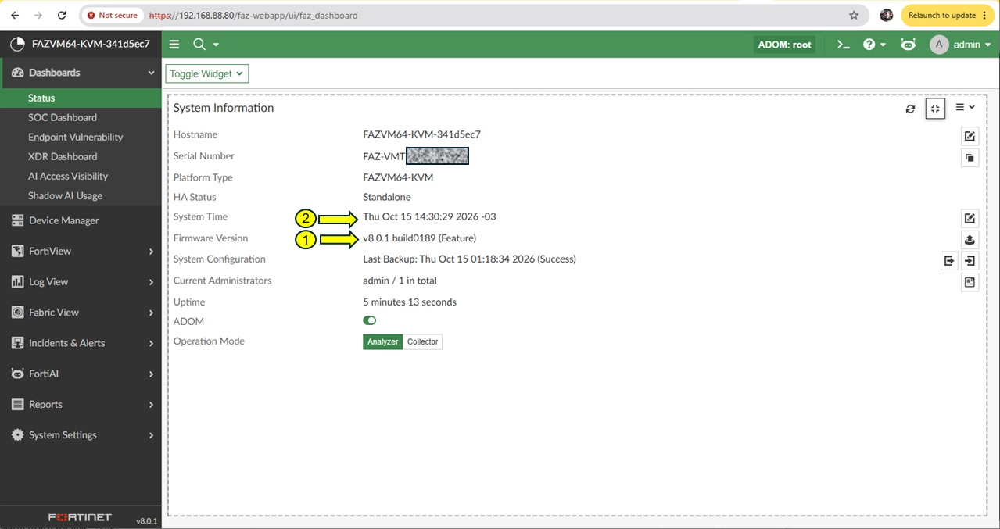
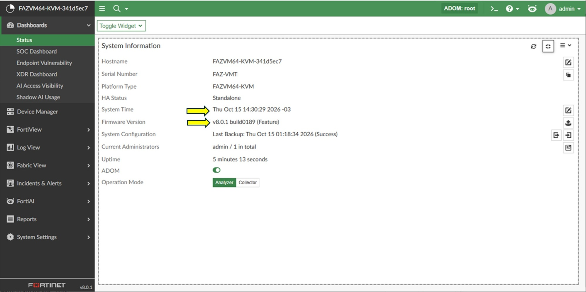
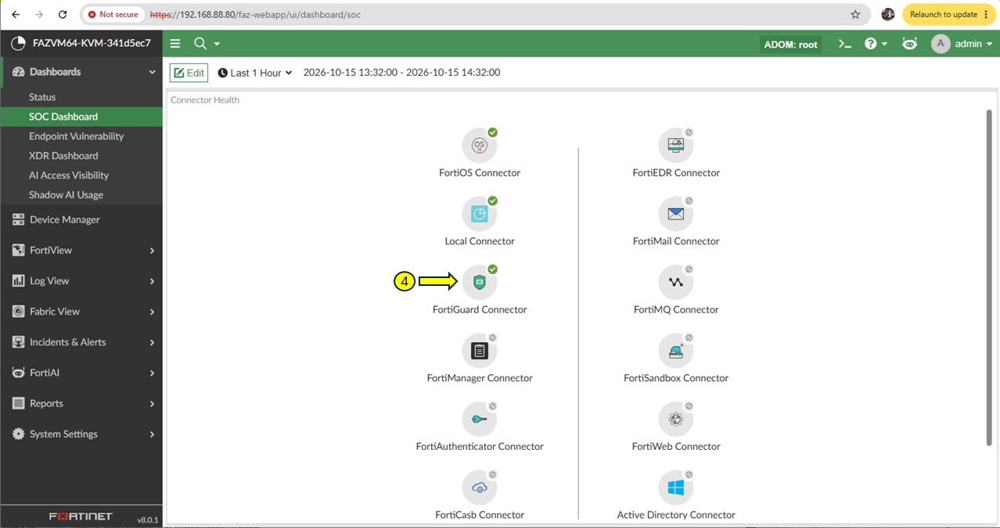

# meraki-fortianalyzer-soc-integration

## Introduction

Welcome to the Cisco Meraki MX to FortiAnalyzer integration guide. This project includes a custom parser designed to accurately translate and map Meraki MX event types and parameters into FortiAnalyzer, alongside comprehensive documentation to walk you through the entire deployment process.

## Overview

The FortiAnalyzer Security Automation Service is a license that provides content packs released from FortiGuard on a monthly basis. The content packs include premium reports, alert handlers, advanced correlation rules, third-party log parsers, and more. These tools are designed to help you detect, investigate, and respond to security incidents. For more information about this service, see FortiAnalyzer Security Automation Service on the FortiGuard website.

Cisco Identity Services Engine logs
FortiAnalyzer supports normalizing Cisco Identity Services Engine logs as Fabric logs.

This log parser enables FortiAnalyzer to parse Cisco Identity Services Engine (ISE) authentication-authorization-accounting syslogs, and normalize user, device, and policy fields into SIEM data. It also provides full AAA visibility through comprehensive field extraction.

## Enviroment Requirements

FortiAnalyzer 7.6.4 or later
FortiAnalyzer SOC Automation Service valid license

## Instalation Requirements

1. Verify your FortiAnalyzer current Firmware Version.
2. Verify that your FortiAnalyzer system time is udpate and in sync.

3. Verify that your FortiAnalyzer in fylly connected and registered with Forticare Support, and that you have a valid SOC Automation Service license.

4. Verify that or Fortianalyzer conection with Fortiguard is healthy

